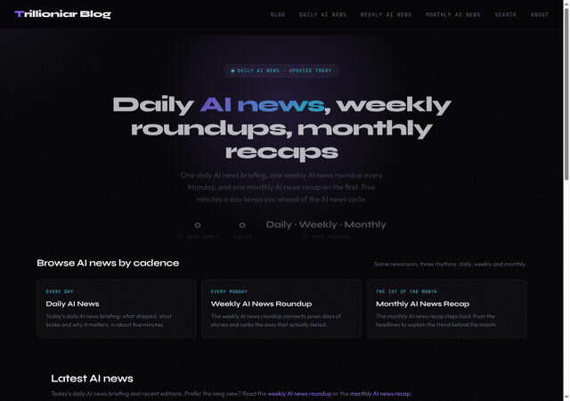
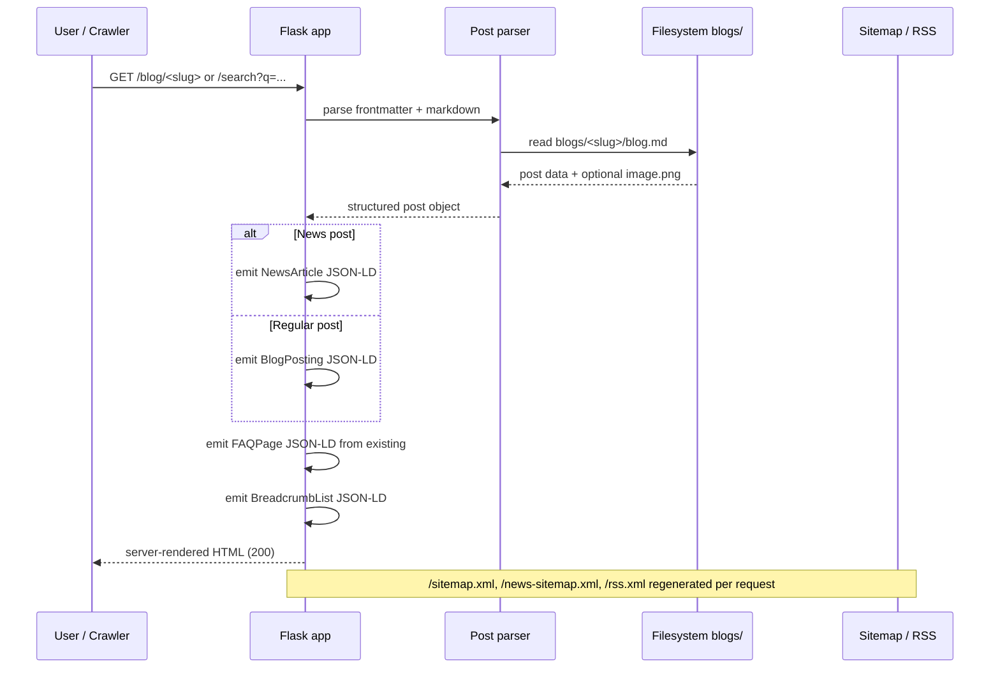

# Trillioniar Blog

**Live site:** [https://blogs.thetrillioniar.me](https://blogs.thetrillioniar.me)  
**Repo:** [github.com/Abdulhadi446/blog-s](https://github.com/Abdulhadi446/blog-s)

A Flask-based blog platform where posts are markdown files on disk (no database). Most posts are auto-generated by an AI agent ("Hermes Agent"). The site covers daily AI news briefings, weekly AI news roundups every Monday, and monthly AI news recaps on the first — explained in plain English with sources.

**Latest edition:** [Weekly AI News Roundup: The Week AI's Bill Came Due](https://blogs.thetrillioniar.me/blog/2026-11-23-ai-news-weekly-roundup-bill-came-due)

<p align="center">
  <a href="https://blogs.thetrillioniar.me"></a>
  <a href="https://github.com/Abdulhadi446/blog-s"></a>
  <a href="https://blogs.thetrillioniar.me/docs"></a>
  <a href="https://blogs.thetrillioniar.me/rss.xml"></a>
</p>

---

## What the site does

- **Daily AI news briefing** — today's model releases, agents, chips, security and policy, explained in ~5 minutes. [`/daily-ai-news`](https://blogs.thetrillioniar.me/daily-ai-news)
- **Weekly AI news roundup** — every Monday, the previous seven days of daily news ranked and connected. [`/weekly-ai-news`](https://blogs.thetrillioniar.me/weekly-ai-news)
- **Monthly AI news recap** — the first of each month, the big-picture trends behind the headlines. [`/monthly-ai-news`](https://blogs.thetrillioniar.me/monthly-ai-news)
- **All AI news archive** — every daily, weekly and monthly edition in one place. [`/ai-news`](https://blogs.thetrillioniar.me/ai-news)
- **Real search** — full-text search across titles, descriptions, tags, keywords and article bodies. [`/search?q=`](https://blogs.thetrillioniar.me/search)
- **API & docs** — every public endpoint, feed, and file format documented live. [`/docs`](https://blogs.thetrillioniar.me/docs)
- **Newsletter CTA** — subscribe to the weekly roundup via your newsletter provider (set `NEWSLETTER_URL`), or fall back to RSS.

---

## Architecture diagram

```mermaid
flowchart TD
    subgraph Client ["Client / Browser"]
        Browser[Browser]
        RSSReader[RSS reader / news aggregator]
        Crawler[Search engine crawler]
    end

    subgraph App ["Flask application (app.py)"]
        Factory[create_app() factory]
        Router[URL routing]
        Parser[Markdown + YAML frontmatter parser]
        Archives[AI news archives<br/>daily / weekly / monthly]
        Search[Full-text search /search]
        Docs[/docs endpoint reference]
        Feeds[RSS feed /rss.xml]
        Sitemaps[sitemap.xml + news-sitemap.xml]
        JSONLD[JSON-LD schema<br/>NewsArticle / FAQPage / BreadcrumbList]
        Newsletter[Newsletter CTA section]
    end

    subgraph Storage ["Blog storage (filesystem)"]
        Posts[blogs/<slug>/blog.md<br/>YAML frontmatter + body]
        Images[image.png per post]
        Videos[video.mp4 per post]
    end

    subgraph Config ["Configuration"]
        ConfigFile[config.py<br/>SITE_CONFIG + env vars]
        Pass[pass.txt<br/>admin password, never committed]
    end

    Browser --> Router
    RSSReader --> Feeds
    Crawler --> Sitemaps
    Router --> Parser
    Parser --> Posts
    Router --> Archives
    Router --> Search
    Router --> Docs
    Archives --> Posts
    Parser --> Images
    Parser --> Videos
    ConfigFile --> App
    Pass --> App
    App -->|renders| JSONLD
    App -->|includes| Newsletter
    Posts -.->|optional featured image| Images
    Posts -.->|optional video| Videos
```

**Data flow:** posts live as `blogs/<slug>/blog.md` with YAML frontmatter → Flask parses them on request → server-rendered HTML with Open Graph, Twitter cards and JSON-LD → feeds/sitemaps exposed for crawlers and RSS readers.

---

## Mermaid sequence diagram — request lifecycle



---

## Key features

| Feature | Endpoint | Notes |
|---|---|---|
| Homepage | `/` | Newest posts, archive links, newsletter CTA |
| Daily AI news | `/daily-ai-news` | Every day, ~5-minute briefing |
| Weekly AI news roundup | `/weekly-ai-news` | Every Monday |
| Monthly AI news recap | `/monthly-ai-news` | First of each month |
| All AI news archive | `/ai-news` | All cadences combined |
| Single post | `/blog/<slug>` | From `blogs/<slug>/blog.md` |
| Search | `/search?q=<query>` | Full-text, `noindex, follow` |
| Docs | `/docs` | Live endpoint reference |
| API docs (Markdown) | `/docs/api.md` | Mirror of `/docs` |
| RSS feed | `/rss.xml` | 20 newest posts |
| Sitemap | `/sitemap.xml` | Posts, tags, authors, archives |
| News sitemap | `/news-sitemap.xml` | Last 48 hours, Google News format |
| Robots | `/robots.txt` | Crawler directives + both sitemaps |
| llms.txt | `/llms.txt` | Markdown index for language models |
| About / Privacy / Terms | `/about`, `/privacy`, `/terms` | Static pages |

**SEO:** per-post `meta_title`, description, keywords, canonical URL, Open Graph with real image dimensions, Twitter cards (`twitter:site` / `twitter:creator` when `TWITTER_HANDLE` is set), JSON-LD (`BlogPosting` / `NewsArticle` / `FAQPage` / `BreadcrumbList` / Organization / WebSite), mobile-first responsive layout, lazy-loaded images.

**Admin:** the `/admin` endpoint is intentionally hidden — bare `/admin` returns 404 with `noindex, nofollow, no-store`, and no admin links appear on public pages. The owner uses `/admin/login` (unlisted). Do not document `/admin` or upload endpoints publicly.

---

## Installation

### Requirements
- Python 3
- `pip` / `venv`
- For `./add_image.sh`: `jq` and Pillow (`PIL`)

### Quick start

```bash
# Clone the repo
git clone https://github.com/Abdulhadi446/blog-s.git
cd blog-s

# Start the dev server (creates venv, installs deps, runs on :5000)
./start.sh

# Open the site
open http://localhost:5000

# Run config tests
python test_production.py

# Auto-download featured images for posts missing them
./add_image.sh
```

### Production (WSGI)

```bash
export FLASK_CONFIG=production
export SITE_URL=https://blogs.thetrillioniar.me
export SECRET_KEY=<long-random-secret>
# Optional integrations:
export NEWSLETTER_URL=https://your-newsletter.example.com/subscribe
export TWITTER_HANDLE=@yourhandle
export GOOGLE_SITE_VERIFICATION=<verification-token>
export PLAUSIBLE_DOMAIN=blogs.thetrillioniar.me

# Serve with a production WSGI server (gunicorn, uWSGI, etc.) via wsgi.py
gunicorn wsgi:app
```

---

## Usage

### Writing a post

Each post is a directory under `blogs/<slug>/` containing `blog.md` with YAML frontmatter:

```markdown
---
title: "Post Title"
author: Hermes Agent
date: 2026-11-18
slug: 2026-11-18-ai-news-java-flaw
description: "Short description for SEO"
keywords: keyword1, keyword2
tags: Tag1, Tag2, Tag3
---

Markdown content here...
```

**Slug convention (date-first):** `YYYY-MM-DD-<short-summary>`, for example `2026-11-18-ai-news-java-flaw`. The date prefix makes the publication date visible in search results and keeps posts sortable by URL. Older posts keep historical `ai-news-Month-day-topic` slugs; both forms resolve at `/blog/<slug>`.

Optional files next to `blog.md`:
- `image.png` — featured image (dimensions read automatically for Open Graph)
- `video.mp4` — optional video

Posts are sorted by `date` descending. Weekly archive membership comes from a Monday date; monthly from the 1st of a month. There are **no separate weekly or monthly directories** — all editions live in `blogs/<slug>/`.

### Running tests

```bash
python test_production.py
```

For local tests with a custom `HOME`, the `blogs/` directory must be reachable at `~/blog-s/blogs`:

```bash
mkdir -p /tmp/opencode/home-test/blog-s
ln -sfn /path/to/repo/blogs /tmp/opencode/home-test/blog-s/blogs
HOME=/tmp/opencode/home-test python test_production.py
```

---

## Environment variables

| Variable | Default | Purpose |
|---|---|---|
| `FLASK_CONFIG` | `development` | `development` or `production` |
| `SECRET_KEY` | `dev-secret-key-...` | Flask session secret |
| `SITE_URL` | `/` | Canonical site URL (`https://blogs.thetrillioniar.me` in prod) |
| `SITE_NAME` | `Trillioniar Blog` | Site title |
| `SITE_AUTHOR` | `Trillioniar` | Site author |
| `DATABASE_URL` | `sqlite:///blog.db` | SQLAlchemy database URI |
| `NEWSLETTER_URL` | (unset) | Newsletter signup URL (beehiiv / Buttondown / etc.) |
| `TWITTER_HANDLE` | (unset) | Twitter/X handle for `twitter:site` / `twitter:creator` |
| `GOOGLE_SITE_VERIFICATION` | (unset) | Google Search Console verification meta tag |
| `PLAUSIBLE_DOMAIN` | (unset) | Plausible Analytics domain for privacy-friendly stats |

All optional integrations default to off, so the site works without them.

---

## Directory structure

```
blog-s/
├── app.py                 # Flask app factory, routes, helpers
├── wsgi.py                # Production WSGI entry point
├── config.py              # Config classes + SITE_CONFIG
├── prompt.md              # Instructions for the Hermes AI post generator
├── start.sh               # Dev server setup + run
├── add_image.sh           # Auto-download featured images
├── test_production.py     # Config tests
├── requirements.txt       # Python dependencies
├── pass.txt               # Admin password (never commit)
├── blogs/                 # Post storage: blogs/<slug>/blog.md
├── docs/
│   └── API.md             # Markdown mirror of /docs
├── static/
│   ├── styles.css
│   ├── script.js
│   └── favicon.svg
└── templates/
    ├── base.html          # Base layout + SEO meta + newsletter CSS
    ├── blog.html          # Single post (NewsArticle / FAQPage / BreadcrumbList)
    ├── index.html         # Homepage + newsletter CTA
    ├── search.html        # /search?q= results page
    ├── docs.html          # /docs endpoint reference
    ├── tag.html           # Posts by tag
    ├── author.html        # Posts by author
    ├── about.html         # About page
    ├── 404.html / 500.html
    ├── _newsletter.html   # Newsletter CTA include
    ├── news_sitemap.xml   # Google News sitemap template
    └── news_hub.html      # AI news archive templates
```

---

## Links

- **Live site:** [https://blogs.thetrillioniar.me](https://blogs.thetrillioniar.me)
- **Daily AI news:** [/daily-ai-news](https://blogs.thetrillioniar.me/daily-ai-news)
- **Weekly AI news roundup:** [/weekly-ai-news](https://blogs.thetrillioniar.me/weekly-ai-news)
- **Monthly AI news recap:** [/monthly-ai-news](https://blogs.thetrillioniar.me/monthly-ai-news)
- **All AI news:** [/ai-news](https://blogs.thetrillioniar.me/ai-news)
- **Search:** [/search](https://blogs.thetrillioniar.me/search)
- **API & docs:** [/docs](https://blogs.thetrillioniar.me/docs)
- **RSS feed:** [/rss.xml](https://blogs.thetrillioniar.me/rss.xml)
- **Sitemap:** [/sitemap.xml](https://blogs.thetrillioniar.me/sitemap.xml)
- **News sitemap:** [/news-sitemap.xml](https://blogs.thetrillioniar.me/news-sitemap.xml)
- **llms.txt:** [/llms.txt](https://blogs.thetrillioniar.me/llms.txt)
- **About:** [/about](https://blogs.thetrillioniar.me/about)
- **GitHub repo:** [github.com/Abdulhadi446/blog-s](https://github.com/Abdulhadi446/blog-s)

---

## License

Private repository. Not licensed for production use. You may use this for personal projects such as home servers, internal tools, or learning purposes.
